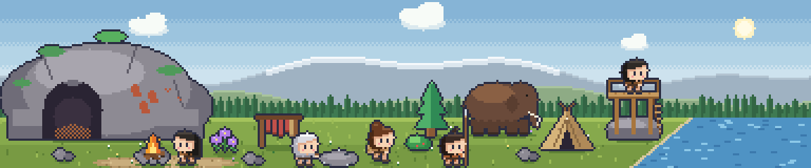

# Ages (eras)

Status: **direction agreed; the sim supports eras and the slice is re-themed.** This extends the MVP concept's progression (Camp → Hamlet → Village, the Knowledge axes and the Wild ↔ Developed axis) with a long-term arc: the game starts in the Cave Age and the settlement progresses through later ages gradually. Art for the Cave Age is not drawn yet; the on-screen art is still the earlier cottage-era placeholder set.

## Decisions

| # | Decision | Why |
|---|---|---|
| G1 | The game **starts in the Cave Age** (hunter-gatherers living in caves) | Player's vision for the game. |
| G2 | **Ages are linear, but the player's choices decide how they get there and what the age looks like.** Not branching into different ages per player | The MVP's "knowledge" axes (Agriculture / Craft / Exploration) drive the transition, so one player's Settled Age is farmland, another's is herding or craft. Linear ages keep the art and content scope bounded. |
| G3 | **Sequencing: decide the structure now, draw art one age at a time.** Age 1 art first; later ages are content packs | Art cost multiplies per age; the sim and content only need the era *structure* up front. |
| G4 | **Change is gradual and cumulative**: new buildings and props appear and older ones stay (the cave remains as storage), so the world accumulates history instead of being replaced | Matches "the player's desktop physically becomes more populated"; also cheaper than swapping whole scenes. |
| G5 | An **age** is a content/art pack and tech level; a **chapter** is settlement size within it (the MVP's Camp → Hamlet → Village milestones) | Keeps two different ideas apart. |
| G6 | **Every age is about as long as the Cave Age**: five or six hidden milestones spread over about five real days, with small decisions and quiet lines between them | The pace should feel the same from age to age; a short age feels like a skipped chapter. |
| G7 | **The game is open-ended.** The newest age has no end, no final milestone and no credits: its milestones are the *gate* of an age that does not exist yet. A later age is added as data (an `EraDef` whose `required_achievements` are the previous age's milestones, plus content and art), with no change to the engine | Room for future updates; nothing is ever "finished". |

## Settled Age: the milestones

Agreed. Like the Cave Age's, these are hidden achievements (G6, G7) staged over the age, each with
more than one route; the choice made at the turn (`path_agriculture` by the field, `path_herding`
where the herds winter) decides which routes a group is offered, and one late route is open to
every group. Days are **days into the Settled Age** (`SimCondition.ERA_DAYS_AT_LEAST`, one table:
`SETTLED_DAY` in `tools/build_sim_content.gd`), so the pace is the same however long the Cave Age
took. 72 days is a real day.

| # | Milestone | Real-world turning point | Ways it can happen | From day | On screen (art, later) |
|---|---|---|---|---|---|
| 1 | **A Roof of Your Own** | Permanent houses | Build the Hut; or thatch the roofs with reed, or lay turf over the poles (both earn it) | 18 | Huts, thatch |
| 2 | **The First Harvest** | Farming and herding yield | Build the Field (either path); or, when herding, the first calves are penned or sent to graze (both earn it) | 18 (Field), 54 (calves) | Fields, a pen and herd |
| 3 | **Fired Clay** | Pottery | A basket's clay hardens by the fire: fire a pot in the embers, or bake a dish on hot stones; or bake bowls in the ashes or in a pit under the cook fire | 108 | Pots by the door |
| 4 | **Woven Cloth** | Weaving | Farmers find flax (spin it or beat it and weave); herders gather wool (spin or felt it); any group may plait reeds (teach it, or plait finer; from day 198) | 162 | Looms, cloth |
| 5 | **A Village** | Community | Two families on the road are made room for, or offered the ground by the river (needs milestone 1); or a long harvest table (10 food), or a dish from every family at the old fire (a little later) (needs milestone 2) | 216 | More villagers |
| 6 | **Word from the Hills** | Metal ore, trade | A curious villager brings back a green-streaked stone and follows the stream to its source, or shows the bead to the elders (a little later); or a traveller trades a pouch of it for 8 food, or is asked back with more (needs milestone 2). Sets the flag `green_stone` | 252 | A path into the hills (later) |

- **Why these six.** They are what the next age stands on, and the candidate next age is the **Bronze Age** (metal, trade, walls, first towns; not designed yet). A surplus (2), kilns (3), craft goods to trade (4) and a settlement big enough to need walls (1, 5) are its preconditions. Milestone 6 is the Settled Age's outward look, as the scout and the seed were the Cave Age's: copper ore, and the first contact with people who trade. The Bronze Age's turn event would read `green_stone` and ask *how* to start working it, as the Settled turn asks how to settle. Until Bronze is designed this is only a stated direction.

- There is no gate out of the Settled Age yet (G7): once the six are earned the age simply keeps
  going. The Hut and the Field are offered together by the "Building a settlement" decision from
  day 18 of the age: a real fork, so the one not chosen stays unbuilt (each milestone has other routes).
- The Cave Age's design rules carry over (P13): every answer does something, and a test (`test_sim_settled.gd`) plays
  from the turn on both paths, accepting everything and taking the last answer twice first, and
  proves all six are earned, never before their day (the Field's harvest may come with the roof).
- **Still to do for the Settled Age**: nothing planned. Its milestones, fill, skin, world art and clothes are in (V8, V10); the next age is the Bronze Age (not designed).

## Settled Age: between the milestones

Same rules as the Cave Age's fill (two answers that each do something, a journal line each, a flag a later line remembers, nothing fails), paced by one table (`SETTLED_STORY_DAY`, days into the age). A bot answering at once is asked something every 2-5 real hours across the age (five forks were added in the longest stretches: mud at the door, the longest day, small hands, three days of fog, the long evenings). Costs are bigger than the Cave Age's (4-25) because the stores are fuller; they are what the stores are for.

| From day | Decision | What the answers do |
|---|---|---|
| 2 | **What the cave is for** | Make it the winter store, or keep it for sleeping and old stories |
| 8 | **Whose ground** | Boundary stones (4 wood), or leave the ground open |
| 14 | **The digging sticks** (farmers) / **Into the sown ground** (herders) | A forked branch pulled together, or digging by hand; a hurdle gate (6 wood), or a watcher |
| 38 | **Rain through the thatch** (needs a roof) | Patch it (6 wood), or wait |
| 46 | **A place to fetch water** | Dig a well (8 wood), or keep carrying |
| 58 | **Birds in the field** (farmers) / **A dog at the fold** (herders) | A scarecrow, or turns chasing; feed the dog (2 food), or leave it |
| 70 | **Damp grain** (needs a harvest) | A clay-lined pit (6 wood), or hang the baskets |
| 82 | **Over the fence** (a social villager) | Sit them down together, or let it cool |
| 92 | **More than enough** (needs a harvest) | A festival (20 food), or lay it by |
| 100 | **Before the huts** (a social villager) | Tell the whole story of the cave, or a short one |
| 118 | **A pit for the pots** (needs fired clay) | Build a kiln (15 wood), or keep baking in ashes |
| 130 | **Nine days of rain** | Dig a ditch (8 wood), or wait |
| 142 | **Small brown birds** | Scatter grain (3 food) for hens, or let them be |
| 172 | **A colour for the cloth** (needs cloth) | Dye it (6 food), or keep it plain |
| 184 | **Two posts and some thread** (an industrious villager, needs cloth) | Build a loom (8 wood), or stay with the spindle |
| 196 | **The river is rising** | Raise a bank (20 wood), or move what you can |
| 208 | **Smoke beyond the ridge** | A gift of grain (12 food), or watch and wait |
| 226 | **Salt** (needs fired clay) | Trade pots for salt (+6 food), or keep the pots |
| 238 | **Before winter** | Lay in firewood (15 wood), or trust the stores |
| 262 | **What the stone does** (a curious villager, needs the green stone) | Shape beads for everyone, or put more in the fire (sets `copper_tried`) |
| 286 | **How far the village goes** | A low wall (25 wood), or leave it open |
| 312 | **Up at the cave** (a nature-loving villager) | Light the cave once a year, or let it be |

- **Looking outward and forward.** The last few answers set flags a Bronze Age can read: `green_stone`, `copper_tried`, `low_wall`, `open_village`, `good_neighbours`, `salt`, `kiln`.
- **Ambient lines**: 23 one-line moments, each rarer than a Cave Age line (`SETTLED_AMBIENT_CHANCE`) because the Cave Age lines keep happening too. Some only after a milestone (swallows in the eaves; bread; a pot's ring; a spindle), some only for farmers or herders, five about a trait (never told while the villager sleeps), and eight remember an answer (the well water, the scarecrow's hat, the festival tune, the kiln night, the red tunic, the low wall, the beads).

## Candidate ages (for reference)

| Age | Life | Visible change |
|---|---|---|
| 1. Cave | Hunter-gatherers, fire, hides, flint tools | Caves, fire pits, lean-tos, furs, big game |
| 2. Settled | Farming, herding, pottery, weaving | Huts, fields, pens, storage (reuses much of the current farm/tent art) |
| 3. Bronze | Metal, trade, walls, first towns | Mud-brick, workshops, roads |
| 4+ | Iron, classical, medieval | Out of scope for now |

Recommended MVP scope: Age 1 in full, Age 2 as the first transition, Age 3 as a horizon only. Not yet confirmed.

## How the first slice fits

The slice's chain (a curious villager scouts, brings back a wild seed, the player plants it, it flowers) is the **origin of farming**, and it is the last milestone before the Cave Age can turn into the Settled Age (see the gate below). When the whole gate is met, the group is asked *how* to settle (by the field, or where the herds winter); both answers advance the age.

## Cave → Settled: the gate

Agreed. The player is never shown this list or the minimum time (see `gameplay.md` P8). All six
milestones must be earned, and the minimum time must have passed. Milestones are achievements.

| # | Milestone | Real-world turning point | Ways it can happen | On screen | Unlocks |
|---|---|---|---|---|---|
| 1 | **Fire** | Controlled fire | A curious villager finds a tree burning after a storm, or sparks fly while knapping | Fire pit lit, warm night glow, villagers gather at it | Everything below |
| 2 | **Stone tools** | Knapping | An industrious villager works at a flint spot, or a tool is found while cracking nuts | Knapping spot, tools in hands | Hunting, building |
| 3 | **Reliable food** | Organised hunting or foraging | *Hunt*: spears and a shared hunt. *Gather*: baskets and drying | Spears or baskets, drying rack, hides | Furs, growth |
| 4 | **Shared stories** | Language, art, ritual | Social villagers talk by the fire, or someone paints the cave wall | Ochre handprints on the cave wall | Trait events |
| 5 | **A bigger group** | Bands joining | Wanderers arrive once the camp is secure (at least 2 newcomers) | More villagers | Settling |
| 6 | **Seeds of a new life** | Origin of farming | A scout brings back a seed, someone plants it, it flowers (the existing chain) | The strange flower by the cave | The Settled Age |

- **Order**: Fire first; the rest are **staged over the age** so it is not finished in an afternoon: Stone Tools from game day 18 (about 6 real hours), Enough to Eat from 54 (18 h), Shared Stories from 108 (1.5 days), A Bigger Group from 162 (2.25 days) and the seed chain from 216 (3 days). Stone tools come before hunting. The numbers are one table in `tools/build_sim_content.gd`.
- **Minimum time**: about 5 real days (to tune). Time while the game is closed counts.
- **Choices that shape it**: milestone 3 can be met by hunting or gathering (different look); whether the flower is planted is the player's call; the age-turn beat can be a *how* choice (how to settle), not a *whether*.
- **Safeguards**: if a milestone is still missing after the minimum time, a fallback chain makes it eligible; declined decisions come back; a test proves every milestone is reachable, including for a player who keeps declining.

## Cave Age: between the milestones

The milestones are far apart (hours to days), so each stretch has its own small decisions and a stream of one-line journal moments. None of it is required, nothing fails, and every answer does something small: it shows up in the journal and sets a flag that a later line remembers. There is no "pass" answer (P13). Which game day each opens is one table (`STORY_DAY` in `tools/build_sim_content.gd`); 72 game days is a real day. The first building decision is not asked until day 18 (about 6 real hours), because it needs two buildings to choose between; the Lookout is the only one open before then.

| From day | Decision (two answers each) | What the answers do |
|---|---|---|
| 4 | **A wolf at the edge** | Leave scraps (2 food) or drive it off; the wolf is remembered in later lines |
| 6 | **Hungry mornings** (only when food is low) | Forage together or set snares; food and a flag |
| 24 | **What the edge is for** (needs Stone Tools) | Hand axes (wood) or hide scrapers |
| 32 | **The first hard frost** | Keep the fire high all night (8 wood) or huddle close |
| 42 | **Strange prints** (a curious villager) | Follow them (away 18 ticks, comes back with pine nuts) or read them together at dawn |
| 60 | **More than enough** (needs Enough to Eat and a full store) | Hold a feast (12 food) or dry the rest |
| 72 | **The warm spot** | A second small fire (6 wood) or take turns |
| 88 | **The neighbour** (the mammoth at the camp's edge) | Offer greens (3 food) or keep a distance |
| 115 | **A rhythm to work to** (needs Shared Stories) | Let everyone join in or ask for quiet |
| 126 | **The crowded wall** (cave art route) or **The long story** (storytelling route) | Paint the herd or the sky; or fix the story or let it change |
| 140 | **Smoke on the ridge** (needs the Lookout; before the strangers) | Send a scout (finds a cold fire ring) or keep watching from the lookout |
| 172 | **Room for the newcomers** (needs A Bigger Group) | A shelter (8 wood) or share the cave |
| 192 | **The river is rising** | Carry the stores up (6 wood) or trust the bank |
| 232 | **Heavy grass** | Gather every seed head (10 food) or half, leaving the rest to scatter |
| 252 | **A limping deer** | Tend it (3 food) or let nature take its course |
| 272 | **A traveller with dark stone** | Trade food (8) for the stone or share a meal |
| 294 | **Counting stars** (a curious villager) | Name the shapes together or let them keep the sky |
| 316 | **Smoke in the cave** | Open a gap in the roof (8 wood) or live with it |
| 342 | **The pile by the cave** (an industrious villager) | Sort the good stone or bury it |

- **Ambient lines**: about 25 one-line moments (mist, a heron, geese, thunder; a curious villager watching ants; a social one humming; an industrious one stacking wood; a nature-loving one bringing back crocuses; plus lines that remember an earlier answer). Each repeats at most every 5 real hours (360 ticks). A line about a villager is never told while they are asleep (`SUBJECT_AWAKE`).
- **Pace** (bot answering at once, `tools/sim_timeline.gd`): about 44 questions across the 5 days including the buildings and milestones, never more than about 5 real hours apart (it was 8-9 before 13 more small forks were added in the longest stretches, so a workday is never without one), and a journal line roughly every 20 real minutes. Added forks: the cold floor (11), the missing flint (80), scratching in the night (98), the hard crossing (152), a bright feather (182), bats in the back (204), the bee tree (227), the run of fish (246), a hollow log (265), the first snow (285), the cave answers (307), a stone from the sky (331) and the warm pool (350). Move a day in `STORY_DAY` if a stretch feels long.
- **Resources stay context** (P2): a choice shows what it needs and only waits for it. Villagers stop gathering a resource once the store reaches `comfortable_stock` (40), and buildings stop adding to a full store, so stock hovers around that instead of piling up; building costs are 8-14 wood.

## What is built in the sim

- `EraDef` (id, name, `order`, intro text, and the hidden gate: `required_achievements`, `min_ticks_in_previous_era`, `turn_event`) in `ContentLibrary.eras`; the world stores the current `era`, `era_order` and `era_started_tick`.
- `EraSystem` opens the next age when its gate is met: it fires the turn event (or advances at once). `SimCondition.ERA_AT_LEAST` gates events and choices; `SimEffect.ADVANCE_ERA` moves forward only and writes the era's intro to the journal. Buildings can grant a milestone on completion (`BuildingDef.completion_achievement`).
- Built: all six milestones. Under P13 every answer to a milestone decision does something and still gets there, so no answer is a pass: the other answer reaches the same milestone by a different, slower or differently flavoured road, and a building is never the only way. Fire (carry a burning branch home, or wait and take the embers; the embers come about 2 to 3 days later). Stone Tools (the Knapping Spot, a kept split stone, or keep cracking nuts with it until it breaks). Enough to Eat (the hunt, foraging until the baskets prove their worth, or the Drying Rack). Shared Stories (tell it or sing it; mark the wall or paint faces). A Bigger Group (welcome the strangers, or leave food and they come in on their own). Unexpected Garden (the seed chain: scout alone or walk out together; plant in sun or shade). The **Lookout is optional**: with it the strangers and the scout come at their staged day; without it the same events come a month later (`NO_LOOKOUT_DELAY`) with text that does not mention a tower. `test_decision_rules.gd` plays every order of building picks, and a player who ignores the building question for good, to the Settled Age.
- Milestone events let *anyone* at home be the subject; a matching trait only makes someone likelier (`EventDef.trait_weights`), so no random group can be locked out.
- Newcomers get a random unused name and traits (`Simulation.add_villager`), and reuse the three villager looks until more art exists.
- **Population and food** (issue #7). *Eating*: `FoodSystem` takes `food_per_villager_per_day` (0.35) per villager each tick: everyone eats the same, whatever the size of the group. Production is not per head: only villagers who are foraging or hunting make food, and they share the ground, so each of several out at once brings back less (`forage_crowding` 0.6: two bring back 1/1.6 of a lone forager's catch each, three 1/2.2; `VillagerSystem.shared_ground`). Villagers building or cutting wood are not affected, and nor are the Field and the Drying Rack. So a bigger group needs a bigger share of its days on food, at the cost of wood and building (a cave of eight sits below the cap; eleven goes hungry; the Settled Age's Field feeds far more than that, so a Settled village does not). Roles that drive what each villager does (a food worker makes food, a scout or builder does not) are left for the Bronze Age (#6): today professions are labels. The stock never goes below zero and nothing happens to anyone: while food is below the strip gauge's *low* line (`VillagerSystem.is_hungry`) villagers forage and hunt three times as often and gather wood and build half as often, so a shortage costs only what does not get done. Eating runs in offline catch-up exactly as ticking does. New worlds start with 12 food so the first days are not already hungry. *Room*: the camp holds `EraDef.housing` (Cave 6, Settled 8) plus each completed building's `BuildingDef.housing` (the Hut +3) plus `ContentLibrary.flag_housing` (the answer flags `lean_to` +2 and `extra_roofs` +3); `SimCondition.HAS_ROOM` (negate for crowded) gates arrivals, and `SimConfig.max_villagers` (14) is a safety net `add_villager` refuses beyond. *Decisions* (all P13 forks; `tools/build_sim_content.gd`, `_growth_decisions`): **A traveller at dusk** (one more joins, or they are fed and sent on; needs room and food), **Too many for the cave** and **Too many for the village** (raise a lean-to or another roof, or a family goes to make their own camp: `REMOVE_VILLAGER` takes the newest villagers who are at home, writes "Name left the group to live elsewhere." for each (as arrivals write "joined the group") and drops whatever waited on them, a leaving and never a death), **Who leads the foraging** (one becomes a *Forager*, the first profession after the scout, or the work is shared; only while food is under 30), **Another family at the door** (take them in, or help raise them a roof by the river) and **A lean spring** (only while food is under 24). Nothing in the milestone routes needs a particular villager, so a group that always lets a family go still reaches the village (tested over a full play).
- Cave and Settled ages exist, with era-gated buildings (Field, Hut), cave-only flavour events and the Settled Age's six milestones (see "Settled Age: the milestones").

## Open questions

- How many ages does the MVP actually cover?
- Which choices shape an age (Agriculture vs Craft vs Exploration?) and how visibly?
- Real-time length of an age at 20 minutes per game day (Cave: about 5 real days minimum, to tune).
- What does the cave look like in the strip (a rock face along the back layer?), and do later ages hide or keep it?

## Cave Age art sketch

`art/reference/cave_strip.png` (layers in `art/reference/layers/cave_*.png`, generated by `tools/art/cave_strip.js`) is a first look at Age 1 in the strip, in the same style and layer structure as the day strip.

- **Cave**: a rock outcrop with a rough dark cave mouth under an overhang and warm firelight inside, ochre handprints on the wall, and a fire pit in the trampled earth in front. The outcrop is a stepped, uneven ridge of tilted strata with lit and shaded faces, cracks, moss and ivy on the ledges and boulders at its foot (redrawn from an earlier smooth boulder shape). It is a big landmark at the left of the strip (about 54 px tall) and stays in every age (V10).
- **Slice buildings**: Lookout (rock outcrop with a platform and ladder, a scout standing on top), Drying Rack (hanging meat and a hide), Knapping Spot (flat stone with flint chips), a hide shelter (a stitched hide cone over pole tips; it stands in for the later Hut), and the strange flower (violet blossoms) by the cave mouth.
- **People**: fur tunics with ragged hems, a bone necklace and bare legs; stone-headed tools; a gatherer with a basket and a hunter with a spear. Same 16 px villager, so all existing poses and hair work.
- **World**: colder sky, a snowy far range, conifer tree line, a woolly mammoth in the back lane, drier grass.

Still rough: the far mountains look like a pale band rather than peaks, fur is hinted at rather than textured, and only some tool poses exist (hammer, spear, axe). Nothing here is final.

## What this changes (still to do)

- **Art**: finish Age 1 (animation, more props, more tool poses); building and prop art keyed by era so later ages can add to the scene.
- **On-screen view**: built (milestone 1) with the Cave Age art split into pieces: backdrop layers, static props, and per-building art with a construction-site stage each. Later ages add their own pieces; `WorldLayout` is where an age's slots live.

## On-screen view decisions

- **V1** Bigger panels (decisions, journal, "while you were away") expand the strip **upward temporarily** while open, then shrink back. The strip itself stays 80 px tall. The click region grows with the panel. **Built** (see V7).
- **V2** Villagers act out their simulated activity (chop near the pine, hammer at the building site, gather at the fire) and are hidden while asleep or away.
- **V3** The scene is tinted by the hour of the day; buildings appear as built, with a site stage while under construction.
- **V4** The game autosaves every 60 seconds and on quit; launching after time away runs the offline catch-up.
- **V5** The world is three pages wide (engine-and-art A8). The strip shows one page, starting on the camp, and the player pans with an arrow on each edge (shown only when there is more that way), click-drag, the wheel, or A/D / arrow keys; Home returns to camp. No automatic camera moves. Small dots show which page is in view.
- **V6** The side pages (art: `tools/art/cave_pages.js`). **West**: a pine forest rising to a snowy ridge, the hunting grounds; it is walkable, and newcomers and returning scouts arrive along the forest path from beyond its west end. **East**: the camp's river, a far bank of reeds that villagers cannot reach, then a spit of grass with pines and a bush that thins into a wide sandy beach (a dithered grass-and-sand band, dune grass, dry sand, a wet edge and foam) with a few palms, and the open sea running off the right edge (issue #17). The river is 30 px narrower on this page than first drawn, so a crossing is believable and the spit has room for river life (#9); the sea is darker and bluer than the river, with surf and long low swells in the ground layer (so strip mode shows them) and three phases (`east_sea_0..2`) that `WorldView` swaps every 0.8 s only while some sea is on screen and the view is drawn. There are no boats, ports or sails yet. The coast is there from the start; the groups of the Cave Age still live by fresh water. The camp's river already crosses the whole ground at the camp's east edge, so the east is water, not a ford; the ridge is in the west. Villagers wander west into the forest (to x = −150) and stop at the camp's river (x ≈ 290).
- **V6b** Before fire the camp is cold and dark (P6): there is **no fire pit**, no firelight in the cave mouth and no glow (the `fire_pit` piece appears when `fire_found` is set), the group sits in the cave mouth, and **nights are darker** (`DayNight.tint(hour, lit)`; days are unchanged). Once there is fire, a dithered warm **glow** (`fire_glow`, drawn additively over the world, villagers included) fades in with the dark round the pit and in the cave mouth. The fire **flickers**: four flame frames (`fire_pit_0..3`) swap every 0.2 s and the glow dips and brightens with them; the clock only runs while there is fire and some of its light is on screen. **Wood is cut at the stump at the west forest's edge** (x = −66), not at the camp. Scouts go to **the western forest** (the east is water), and the lookout watches the ridge beyond it.
- **V6c** **Hunting.** If the group chose to hunt at "The herds are close" (flag `path_hunting`), villagers sometimes go hunting (activity `hunt`, a bit likelier for a curious one, rarer while the larder is comfortable, and a hunt brings back twice a forage's food). Hunters walk to the **far end of the west forest** (x ≈ −340..−290, beyond where anyone wanders) and stand watch with a **spear** (the 11th cell of each villager sheet), facing further west. A foraging group never hunts. Journal lines remember the choice (the hunters back at dusk; baskets heavy with roots). `--flag=path_hunting` shows it without playing to day 54.
- **V6d** **The sky.** The sun and the moon cross the sky with the hour and the stars come out with the dark (`DayNight.sun_position`, `moon_position`, `star_alpha`; art `cave_celestial.js`, `cave_stars.js`). The sun goes from 6:00 to 19:30 and the moon from 19:30 to 6:00, each rising from and setting behind the far hills (so a taller ridge to the west can hide it a little longer, and the cave's cliff hides it in the early morning); the sun takes the dawn and dusk tint so it reddens, the moon is a pale crescent, and the stars fade in through the dusk. They stay fixed in the viewport as you pan (like real sky) and exist only in the opaque window, where the sky is drawn; on the desktop they cost nothing. Before fire the camp is still dark at night but the sky is not. The old baked-in sun is gone from the sky art. Cheap: a few property sets a frame, on whole pixels.
- **Next for the world**: nothing queued here; the Settled Age brings its own art. (An off-screen indicator for events was dropped: the bulb already floats over the scroll, so a decision cannot be missed.)
- **V10** **The Settled Age in the world** (decision agreed: *cumulative, with slots upgraded in place*). The Cave world is kept: the cliff and cave, the hills, the river, the lookout, the drying rack, the knapping spot and the fire pit all stay, because the landscape and landmarks are permanent and the cave becomes the village's old place (`cave_store`, `cave_kept`, `cave_remembered`). What changes: a **slot is upgraded in place** when an age redraws it (Settled draws the Hut and the Field; a later age can draw them again), survival gear recedes as the age goes on (the hide-tent look is gone, and the villagers will swap fur for cloth when `woven_cloth` is earned), and the age **adds pieces that show what the group chose**. No backdrop re-skin. How it works: art lives in `assets/world/<age>/`, and a piece is the newest one the current age has (`WorldLayout.piece_path`, folders in `ERA_DIRS`; `WorldView` retextures buildings, sites and props when the age turns). `SceneProps` (pure, tested) lists the pieces that appear because a flag, an achievement or a building says so, with their draw order and where they sit. Art is drawn by `tools/art/settled_camp.js` (`bundle.py --run settled_camp`, then `--import`). **Built so far**: a thatched roundhouse (the Hut) and a field of ripe wheat (the Field), each with a construction site, at the old slots; and at the west meadow's edge the sown plot (`path_agriculture`: a plot of young shoots; `path_herding`: a small patch) and, for the herders, a fenced **pen with three goats** (`west_plot_farm`, `west_plot_patch`, `west_pen`). Look at them with `--era=settled --build=hut,field --flag=path_herding --cam=-384`. **Answers on the ground** (`SceneProps`, each a flag or an achievement): pots by the knapping spot (`fired_clay`), a kiln with a thread of smoke (`kiln`), cloth drying on a line behind the camp (`woven_cloth`) with a red piece once dyed (`dyed_cloth`), a loom (`loom`), a well (`well_dug`), a scarecrow in the farmers' plot (`scarecrow`), hens by the hut (`hens`), a heap of green stone at the cave's edge (`green_stone`), a low fieldstone wall across the back of the village with a gap for a gate (`low_wall`), and two more roofs at the forest's edge when the group becomes a village (`a_village`). A test checks every prop waits for something the game can actually give, and that a played age shows at least eight. `--flag=a,b` and `--earn=a_village,fired_clay` show them all. **Clothes**: once the group has woven cloth (`woven_cloth`) every villager changes from furs into a woven tunic with a coloured border and collar, trousers and shoes (`tools/art/settled_villagers.js` → `assets/world/settled/villagers/<look>.png`, the same 11-cell layout; `WorldLayout.villager_sheet_path`). The view swaps the sheet live without losing the animation, a villager who arrives later is dressed already, and the popup portrait matches. `--earn=woven_cloth` shows it.
- **V7** The play-loop UI (milestone 2). The strip itself shows only the bulb, the book and a small gear; the menu the gear (or a right click) opens (journal, stores, settings, quit) and the text overlay's fate are P12 in `gameplay.md`. A **bulb** floats at the top right of the viewport while a decision waits (a count when several do), a **journal book** is always there, and a **gear** (a quiet grey cog, right of the book, brightening under the mouse) is always there too; the bulb comes and goes at the left end, so the book and gear never move. All stay put while the world scrolls and stay clickable in strip mode. Clicking the bulb opens the decision in a **panel above the strip** (the window grows upward by the panel's height; the art does not move; the click region takes in the panel). Each choice shows what it needs ("needs 6 wood") and is greyed out with "(have 2)" while unaffordable (P2); choices still locked by a hidden stage are not listed, so nothing hidden is hinted at. Several waiting decisions page with Next. A decision the world has moved past (the fire was lit another way) is withdrawn by the sim. The journal is newest first. On launch, if the player was away at least 5 minutes and something happened, a "While you were away" panel lists the latest events and what is waiting. Esc closes the panel. The font is Pixelify Sans (OFL, in `game/assets/fonts/` with its licence).
- **V9** **Clicking a villager** (gameplay.md P11) opens the same panel with their picture, name, traits, any role (Scout) and a one-line thought. A click is a press and release within 3 px (a longer drag pans the world); the villager in front wins when two overlap; villagers who are asleep or away are hidden and cannot be clicked, but "Next >" walks through the whole group ("1 of 3") including them ("Fast asleep.", "Out in the western forest, far from the camp."). Clicking the same villager again, or Esc, closes it. The thought is picked from short authored lines by what they are doing, their traits, whether there is fire yet ("It is cold in the cave, and dark.") and whether the food is low ("The food pile is getting small."), so scarcity is told as a thought, not a number (P2). It changes every few game hours and holds still in between. Nothing here changes the simulation. The panel for a villager is **shorter than the others** (112 px against 160, `PanelHost.HEIGHTS`): its thought is a few short lines, so a full panel was mostly empty. A short panel keeps the top of the art and the bottom rail and drops the plain middle (`PanelSkin.panel_texture`), traits and role share one line (`VillagerPresenter.byline`) so a two-line thought still fits, and the window grows by the panel's current height, following it if the panel changes kind while open. **The villager list** (the menu's *Villagers*, PanelHost.show_villagers, full height) shows the whole group at once, hidden or not: a flat row per villager, exactly one portrait tall (28x30, the idle cell of their sheet, in the woven tunic once woven_cloth is earned) with the name over a muted line of traits and profession (VillagerPresenter.group), so three rows fit and more scroll. Picking a row reports illager:<id> and the game opens that villager's panel above; the Stores panel no longer lists the group. Professions are shown as plain text, so new ones need no UI work. Look at it with `--panel=villagers`.
- **V11** **The achievements panel** (the menu's *Achievements*, `PanelHost.show_achievements`, full height) lists everything the group has earned, oldest first, two to a row: a round medal icon and the title. Only earned ones: no empty slots, no count, no progress, because the age gate stays hidden (P2, P12); with none yet it says "Nothing here yet." Earning one stays quiet, as before: the journal line ("Achievement: Fire") is the moment, with no sound or flash. It shows every achievement the game grants (the age milestones, and the one-offs "The First Field" / "A Place to Stay" and "A Rare Visitor"). The title shown is the one the group earned it under, so it is saved in `WorldState.achievement_titles` (an achievement can be titled differently by route: "The First Harvest" or "The First Calves"); a save from before that falls back to the content's title, then the key spelled out. Icons are 16 medals in `assets/ui/achievements.png` (`tools/art/ui_achievements.js`, cell order in `AchievementPresenter.ICON_ORDER`; a test fails if the game can grant an achievement that has no icon). Look at it with `--panel=achievements --earn=stone_tools,first_roof`.
- **V12** **The wood and food gauges** (gameplay.md P2) sit at the top right, left of the bulb, always on screen, small and a little muted: an icon (a log pile, a haunch), three pips under it and, only while the stock is clearly moving, a small arrow beside it. No numbers, ever. Pips: one lit is *low* (below 25% of `SimConfig.comfortable_stock`, so under 10), two *fine*, three *plenty* (75% or more, so 30 and up); the fractions are `SimConfig.low_stock_fraction` and `plenty_stock_fraction`. The arrow (`StockGauge`, pure and tested) compares the stock with how it was over the last 48 ticks (two game days, about forty real minutes: stock grows only a unit every few ticks, so a shorter look would almost never see a rise), shows once it has moved by 2 or more and stays until the change is under 1, so it does not flicker; a test plays the real sim to make sure a rise is seen. It needs at least 6 ticks of history, is kept in the view only (never saved, no effect on the sim) and starts blank after a launch or a long absence. Clicking a gauge opens the stores panel, where the numbers are (clicking again closes it), and the gauges are part of the strip's click region. Look at them with `--give=wood:6,food:40`.
- **V8** **Panel skins, one per age.** The panels are dressed by a `PanelSkin` (material, colours, font, where each piece sits in the age's atlas), so the UI itself shows progress: the Cave Age skin is a **stretched hide** with torn sides, a **bone rail** top and bottom lashed with sinew, an ochre handprint, stitched-leather buttons, a bone close button and a brown scrollbar. Later ages get their own (clay, papyrus...); an age with no skin yet uses the Cave one. Costs are drawn as resource icons (a log, a haunch of meat) with the amount, and "(have N)" in muted ink while short. The panel unrolls upward in 6 steps when it opens and rolls up when it closes. Text is Pixelify Sans at 12 px with tight line spacing. **The Settled Age skin** (`tools/art/ui_skin_clay.js` → `skin_clay.png`, `PanelSkin.clay()`) is a **timber frame** (pegged beams top and bottom, a post each side) round a **plastered clay wall** flecked with straw, with fired-clay tile buttons, a wooden-peg close button, planks and a loaf for the cost icons, a woven zig-zag under the title and an ear of wheat in place of the handprint. It has the same atlas layout as the hide, so the panel code does not change; `Game` swaps it when `era_advanced` fires, and `--era=settled` shows it without playing to day 360. Look at it with `--era=settled --panel=journal|villager`.
