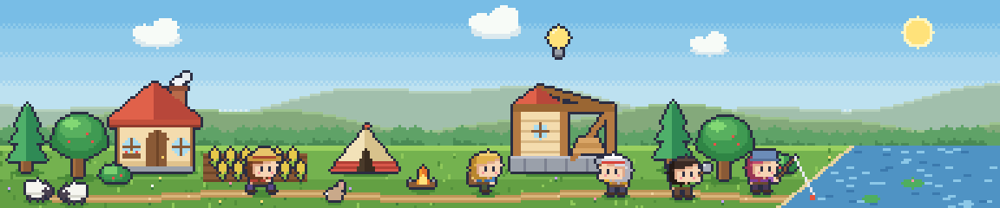
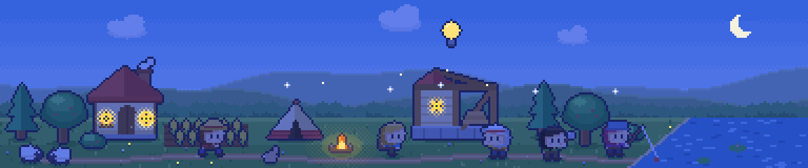
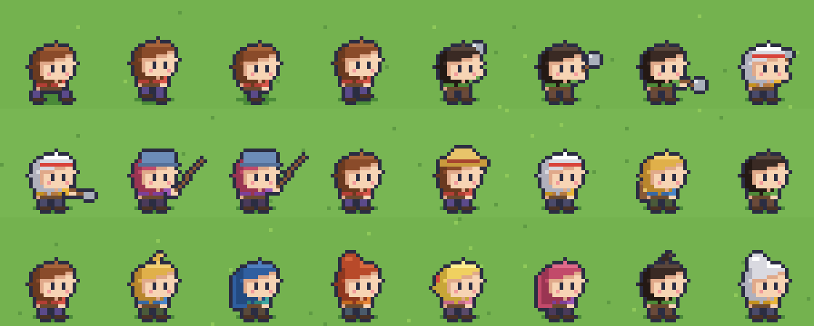
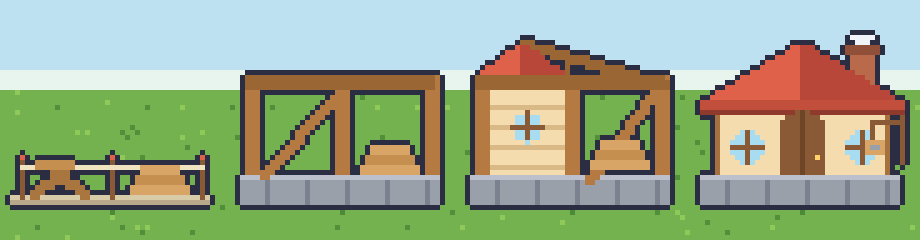
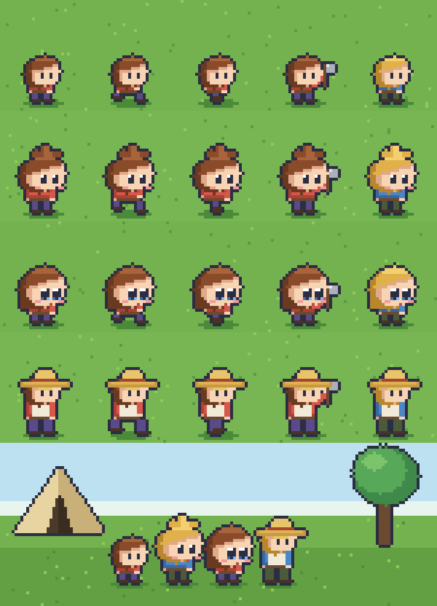

# Engine and art direction

Status: **decided for prototyping**. The Godot window spike (§2.1) validated the core desktop behaviour on one Windows machine; items still marked *(spike)* remain unverified.

Context: [MVP concept](mvp-concept.md) — a tiny world that lives at the edge of the desktop; glanceable, decision-driven, never demanding.

## 1. Decisions

| # | Decision | Why | Revisit if |
|---|---|---|---|
| E1 | **Engine: Godot 4** (2D, GDScript) | Small binary, 2D-first, built-in borderless/transparent windows, always-on-top and mouse passthrough, easy to cap FPS. | The window spike fails on Windows (transparency, click-through, multi-monitor). |
| E2 | **Simulation separate from rendering** (tick-based sim, data-driven events, timestamp-based offline catch-up) | "While you were away" and a glance-only game both need the sim to run without drawing, and to be unit-testable. | — |
| A1 | **Art tool: LibreSprite**, scripted | Free; its JS scripting lets art be generated/reproduced from source (see [pipeline](#5-art-pipeline)). | We need features LibreSprite lacks (tilemaps, newer Aseprite formats, tags in CLI export). |
| A2 | **View: side-view, 2–3 depth lanes** (diorama) | Only option that works in a ~80–100 px strip; characters need left/right only (flip); one asset set serves strip, corner and window modes. | A later "big window" management mode wants a top-down layout (would be separate art). |
| A3 | **Style: chibi, chunky, rounded, 1px outline** | Cute, readable at glance size, cheap to animate, villagers recognisable by hair/colour. | — |
| A4 | **Villager = "style A" mini chibi, 16 px tall**, professions via overlays | Smallest and cutest; keeps the settlement looking like a settlement; hair/colour carry identity. Chosen over larger/more detailed options (see [rejected](#6-options-considered-and-rejected)). | Faces prove too expressionless at 1×. |
| A5 | **Native strip height ≈ 80 px** (384 px wide test) | At 2× that is 160 px on screen. Test 64–80 px native too. | — |
| A6 | **Day/night and seasons as palette transforms**, not separate art | Night variant produced by a script from the day PNG and reads well. | A shader-based approach in Godot is cheaper (likely: do it there). |
| A7 | **Background is layered** (sky, far hills, near hills, tree line, ground+props), and each display mode chooses layers: normal window shows all; strip/corner drop the sky and far hills and keep near hills + tree line | Keeps depth and "place" on the desktop without covering apps behind. The strip's visible/clickable region is the union of the kept layers, so hills and trees are clickable. | Hills in the strip feel intrusive (drop to tree line only) or too empty (add a taller range). |

## 2. Engine notes

- **Window modes** map to window flags and size: *Strip* (borderless, bottom edge, full width × ~160 px at 2×), *Corner* (small resizable), *Normal*. Postpone the click-through roaming-overlay mode, as in the MVP concept.
- **Cheap when ignored**: cap FPS (15–30 in strip mode), pause rendering when hidden/covered, keep sim ticking independently. *(spike)*
- **Offline catch-up**: store last-seen timestamp; on launch simulate elapsed time in coarse steps and produce a journal summary, not resource dumps.
- **Known risks** *(spike)*: per-pixel transparent borderless windows on Windows can be finicky; Godot cannot reserve desktop space like a taskbar (would need a native extension) — overlaying the bottom edge is fine for MVP; behaviour across multiple monitors/DPI.
- **Spike checklist**: transparent borderless strip window; always-on-top toggle; click-through except on interactive sprites; FPS cap; idle CPU/RAM measurement; integer 2×/3× scaling with nearest filtering; multi-monitor + DPI.

### 2.1 Window spike results (Windows 11, Godot 4.7.1, 2 monitors, 16 cores)

Code: `game/scripts/window/desktop_window.gd` (reusable `DesktopWindow`) and the dev scene `game/scenes/dev/window_spike.tscn` / `scripts/dev/window_spike.gd`. Run with `pwsh -File game/tools/run_spike.ps1`; the HUD lists the hotkeys.

Verified (measured through Win32 APIs and screen captures, not just by eye):

- **Strip mode works**: borderless, transparent, no caption, full usable width × 160 px (2×), docked to the bottom of the usable area (above the taskbar).
- **Per-pixel transparency works**: the world floats over other applications; the sky and far hills are hidden in strip mode, and near hills, tree line and ground remain (decision A7).
- **Always-on-top** toggles at runtime; mode, scale (1–4×) and "next monitor" hotkeys all re-layout correctly, including onto a second monitor with a different resolution.
- **Click-through works**: `WindowFromPoint` returns the app underneath for transparent or off-art points and the game for art points.
- **Integer scaling stays crisp** at 2× via `content_scale_size` + integer scale mode.

Findings that shape the design:

1. **The passthrough polygon also clips drawing.** On Windows, anything outside the polygon passed to `DisplayServer.window_set_mouse_passthrough()` is not displayed at all, so *everything visible must be inside the clickable region* (we use the art's skyline polygon, plus `extra_clickable` for debug UI). Floating things above the skyline (the 💡 bulb, birds, a speech bubble) must extend the region. Only one polygon is allowed.
2. **The editor's F5 embeds the game** in its Game tab, where none of the window flags apply. Use `run_spike.ps1` or untick "Embed Game on Next Play".
3. **Mode switches drop keyboard focus** on the borderless window (the window is re-flagged); the user must click it again before hotkeys work. Mouse interaction is unaffected.
4. **Full-width strips need a world wider than the art.** The 384 px strip is centred; the rest is empty. Real full-width play needs scenery that extends or tiles.
5. **Normal-window mode stays above other always-on-top apps only if the game is also always-on-top.** The `T` toggle now applies in every mode; with it off, the window can sit behind other topmost apps (for example the Copilot app).

Idle cost (full-width strip, walking villager animating, HUD off, debug build run from the editor binary, CPU of one core; GPU not measured):

| Config | CPU (of 1 core) |
|---|---|
| uncapped (vsync) | 24.5 % |
| 60 fps cap | 12.2 % |
| 30 fps cap | 5.9 % |
| 15 fps cap | 2.8 % |
| 5 fps cap | 2.5 % (floor) |
| 30 fps, low-processor mode **off** | 9.2 % |

Working set ≈ 175 MB in this debug run (an export build will be smaller). Takeaways: cap to 15–30 fps in strip mode, and keep low-processor mode **on** (≈ 35 % cheaper at 30 fps).

Still to check by a human on a real desktop (needs eyes and real workflows): behaviour over full-screen video/games, Win+D "show desktop", virtual desktops, taskbar auto-hide, mixed-DPI monitors (both monitors here were tested without display scaling checks beyond the primary's 1.00), maximized windows overlapping the strip, Alt-Tab focus, GPU load in Task Manager, and how it feels to have the strip always on top.

## 3. Art direction

Reference images: [`art/reference/`](../art/reference/) (1× source PNGs) and `previews/` (upscaled).




### 3.1 Style rules

1. **Chunky and rounded.** Prefer ellipses and fat shapes; oversize the charming details (doors, windows, chimney smoke, flower boxes, apples on trees).
2. **1px outline** `#2b2d42` around every object and character (generated, not hand-drawn). Backgrounds (sky, hills, tree line, ground, river) have **no outline**.
3. **Three tones per material** (shade / base / highlight), light from upper-left.
4. **Warm, saturated palette**; sky in dithered bands; no gradients or anti-aliasing; hard pixels only.
5. **Integer scaling only** (2×/3×), nearest-neighbour filtering, snap sprites to the pixel grid.
6. **Read at a glance**: activity must be identifiable from silhouette + colour (tool in hand, hat, apron, backpack) without zooming.
7. **Props scale to the villager.** Villager 16 px; doors ≈ 14–15 px incl. arch; houses 36×38; trees ≈ 22–26 px tall.

### 3.2 Scene layout (strip)

- Canvas 384×80 (test); ground line at y = 56; sky 0–55; two hill layers; round-bump tree line; ground in 3 bands.
- **Layers** (back to front), generated as separate PNGs in `art/reference/layers/`: `sky` (bands, sun, clouds), `far_hills`, `near_hills`, `trees`, `ground` (ground, river, props, villagers). `strip_v2.png` is their composite. Strip/corner modes hide `sky` and `far_hills`; the opaque window shows everything.
- **Lanes** (foot y): back ≈ 64–66, middle ≈ 69–73, front ≈ 74–78. Draw back-to-front by foot y; each object gets an elliptical ground shadow (`#4a8a38`).
- Path winds through the front lane; river enters from the right with a diagonal bank.
- Landmarks sit in the back lane; villagers/animals in the middle and front lanes.

### 3.3 Characters

- Villager style A: head ≈ 11 px wide, body 6×5, legs 3 px; faces **right**, mirror for left. Dot eyes + blush; fringe slanted; shadow row under the fringe.
- Draw buffer 27×27, feet on row 26, body centre column 13 (mirror-safe).
- **Frames**: walk 4 (contact, pass, contact, pass with 1 px bob), chop 3, hammer 2, fish 2, idle 1. Sleep/carry/sit still to do.
- **Professions are overlays on the same body**: farmer = straw hat; builder = apron + red headband; explorer = backpack + teal scarf; woodcutter = plaid shirt; fisher = bucket hat. Hair styles: `short`, `tuft`, `long`, `pony`, `bun` (bun needs rework). Palettes: 8 shirt/hair/pants sets.



### 3.4 Props and buildings

- Round apple tree, pine, berry bush, cottage (chimney + smoke, round windows, flower box), tent, campfire, sheep, rabbit, wheat, decision bulb (💡).
- **Construction stages** are a first-class asset set because "glance and see progress" is the reward: site → frame → half-built → complete (workshop done; do the same for every building).



### 3.5 Day / night

Night = tint (`r·0.36+10, g·0.44+16, b·0.74+52`) with exceptions for self-lit colours (bulb, flames), lit windows, a dithered window glow, a campfire glow, crescent moon and stars. In Godot prefer a palette/colour-grade shader with a lit-window mask rather than baked night PNGs.

### 3.6 Asset size reference

| Asset | Size (px) | Notes |
|---|---|---|
| Villager | 16 tall (27×27 draw buffer) | outline adds 1 px each side |
| Cottage | 36×38 | |
| Workshop | 40×34 | 4 stages |
| Tent | 26×18 | |
| Round tree / pine | 22×26 / 16×26 | |
| Bush / sheep / rabbit | 12×8 / 11×8 / 7×7 | |
| Bulb | 9×12 | |
| Strip | 384×80 (test) | 2× on screen = 160 px tall |

### 3.7 Known art TODOs

- Bulb floats too high above the workshop; wheat rows are busy; sheep/rabbit generic.
- Night: window glow too busy ("sunflower"), sheep go bluish.
- `bun` hair reads as a blob; `tuft` is minimal. Faces are 1–2 px — hand-polish after the style is frozen.
- Missing: campfire/bulb/sheep animation, sleep/carry poses, seasons, weather, wildlife, more buildings, UI icons, achievements art.
- Chop wind-up/strike and hammer frames have no motion smear.

## 4. LibreSprite scripting notes (hard-won)

- `app.command.NewFile()` always opens a **modal dialog** and blocks. Never use it. Instead create a blank PNG on disk and `app.open(path)`.
- **`app.open()` resets the script environment** — everything must be defined *after* it. (The bundler enforces this.)
- Draw with `sprite.layer(0).cel(0).image.putImageData(Uint8Array RGBA)`; read with `getImageData()`. Save with `sprite.save()` / `sprite.saveAs(path)`.
- Use the sprite from `app.open(path).sprite` — `app.activeSprite`/`activeImage` are undefined in `--batch` mode.
- `app.documentation` and `app.command.RunScript.filename` did not work for us; run bundles with the CLI (`libresprite -b --script file`) or paste them into the MCP `run_script` tool.
- Engine is JS with `Uint8Array`; stick to ES5-style code.

## 5. Art pipeline

Source of truth is the **scripts**; PNGs in `art/reference/` are generated and checked in as references. See [`tools/art/README.md`](../tools/art/README.md).

```
tools/art/lib.js            shared drawing library (Buf, outline, palettes, villager, props)
tools/art/strip.js          day strip            -> art/reference/strip_v2.png
tools/art/night.js          night variant        -> art/reference/strip_v2_night.png
tools/art/villager_sheet.js villager frames/variants
tools/art/villager_walk.js  transparent 4-frame walk cycle for the engine
tools/art/workshop_stages.js construction stages
tools/art/bundle.py         bundles lib + script behind an app.open() header; --run executes via CLI
tools/art/preview.py        upscaled previews
```

Regeneration was verified pixel-identical to the originals produced during the design session.

**Not built yet (Godot import):** export spritesheet PNG + JSON frame data from LibreSprite, then a small importer that builds `SpriteFrames`/atlas resources. Aseprite add-ons for Godot probably will not work with LibreSprite's older CLI, so plan on our own importer. Longer term, hand-edited `.ase` files can sit alongside generated sprites; the scripts are best for scenes, props and layout, not final hand polish.

## 6. Options considered and rejected



| Option | Why not |
|---|---|
| **View: top-down** | Needs far more screen height; 4-direction animation; strip layout awkward. |
| **View: isometric** | Same, plus 4–8 directions and the highest art cost. |
| **Villager B** (classic chibi, ~20 px) | Nice, but larger and busier; world gets crowded in a thin strip. |
| **Villager C** (big-eye anime, ~20 px) | Charming up close, turns to mush at 1×, most work per character. |
| **Villager D** (Stardew-like, hat/apron base) | Reads as a generic farmer; the hat hides hair, which carries identity. Its hat/apron live on as *role overlays* on style A. |

## 7. Open questions

- Final strip height (64 / 80 / 96 px native) and default scale (2× vs 3×).
- Is a taller "corner" mode a re-layout of the same assets or a separate scene?
- Seasons: palette-only, or extra tree/ground variants?
- Do villagers get faces beyond dot eyes (expressions for events)?
- Importer design for Godot (per-sprite JSON vs atlas + naming convention).

## 8. Next steps

1. ~~Scaffold the Godot project~~ — done in `game/` (384×80 base, 2× window, integer scaling, Godot AI plugin committed).
2. ~~Godot window spike~~ — done (§2.1); a human pass on a real desktop workflow is still needed.
3. Freeze style, polish villager faces/hair, fix the art TODOs above.
4. Define the LibreSprite → Godot export + importer.
5. Build the camp → exploration → discovery → consequence chain in the sim with placeholder art from this set.
